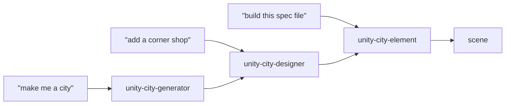
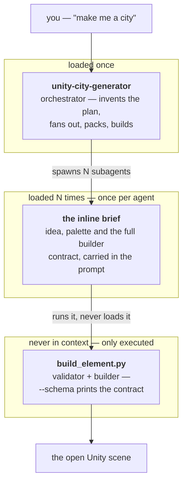
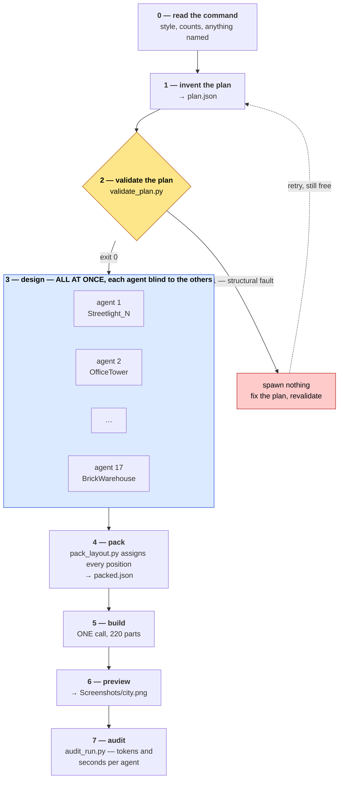
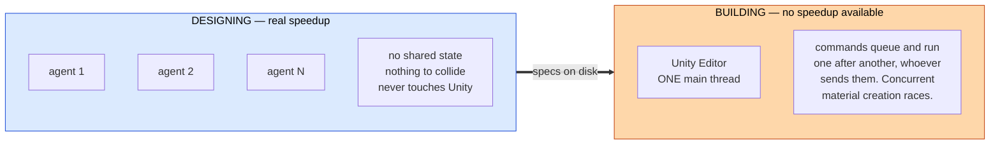
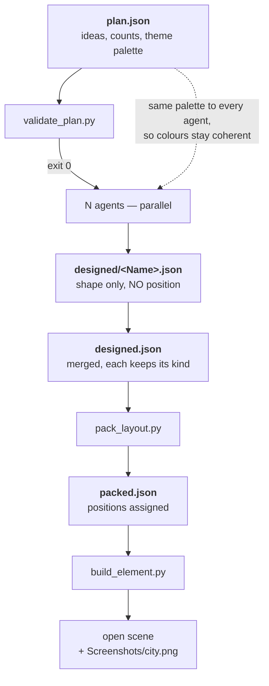
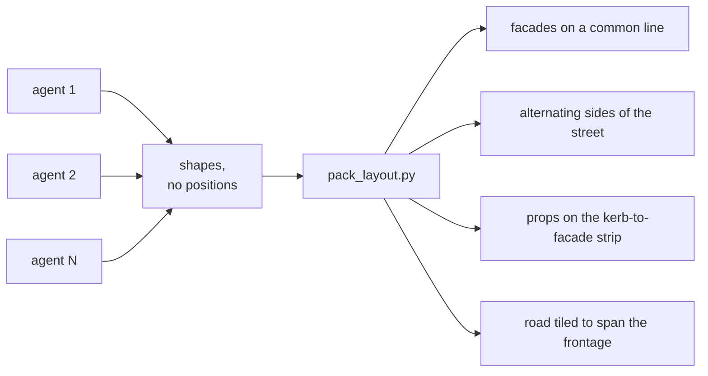
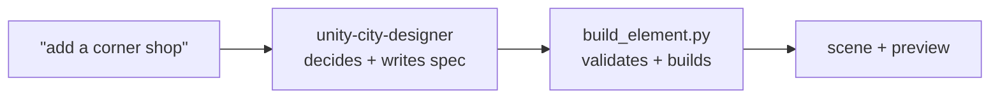

# SoftwareFactories

A Unity 6000.3.15f1 (URP) project with a three-skill stack for generating city
scenery out of Unity primitives, driven from Claude Code through a live Unity
Editor bridge.

Ask for a building and you get one. Ask for a city and you get a street.

---

## Requirements

- **Unity 6000.3.15f1** open on this project, with the command bridge running.
- The `unity` CLI at `/Users/juan/.unity/bin/unity` (not on `PATH` — always call
  it by full path). Override with the `UNITY_CLI` environment variable.
- **Python 3** for the three bundled scripts. No third-party packages.

Check the Editor is reachable before anything else:

```bash
/Users/juan/.unity/bin/unity --no-banner --non-interactive --json status
```

You need an instance with `"state": "ready"`. If it reports something else the
Editor is usually compiling or in play mode — wait and retry. If nothing is
connected, open the project; never fall back to hand-editing scene YAML.

---

## The skill stack

Three skills, each with one job. Only one is loaded per request, so the stack
costs no more than a single skill would.

| Skill | Decides | Produces |
|---|---|---|
| `unity-city-generator` | What a whole block contains | A built street |
| `unity-city-designer` | What one element looks like | A spec |
| `unity-city-element` | Nothing — it builds | Geometry in the scene |



That table answers *which skill handles which request*. For how a run actually
executes — what happens in parallel, what cannot — see below.

---

## How the flow works

The thing worth understanding is **which parts run at the same time and which
cannot**, because that decides both how long a run takes and what can go wrong
in it.

### Who loads what

Only one skill is in context at a time. Layers hand off through files and shell
commands, never by invoking each other as skills.



Neither `unity-city-designer` nor `unity-city-element` is loaded by the
pipeline — both are documentation for *you*. The design agents get a
self-contained brief with the builder contract inlined, which is why a run
costs no skill tokens at all. (This was not always true: on the `ruins` run the
agents found and read the designer skill 115 times between them. They are now
spawned as `city-element-designer`, which has two tools and is told not to.)

### Exactly what the agents exchange

There is no agent-to-agent channel. Every agent is spawned by the orchestrator,
talks only to it, and the real payload goes through **files on disk**, not
through the conversation. Four hops, and each carries a known, small set of
fields:

```mermaid
sequenceDiagram
    participant O as orchestrator
    participant A as city-element-designer (×N, concurrent)
    participant F as city-runs/&lt;run&gt;/designed/
    participant B as build_element.py

    O->>O: plan.json — theme, palette, N ideas
    O->>A: 1. the brief (prompt text, one per agent)
    Note over A: idea · kind · footprint · height<br/>theme · palette · out_path<br/>full builder contract (inlined)
    A->>B: 2. --dry-run on its own file (UNITY_CLI=/nonexistent)
    B-->>A: refusals, or OK + placements
    A->>F: 3. designed/&lt;Name&gt;.json — name, materials, parts
    A-->>O: 4. one line back: "&lt;path&gt;, 14 parts"
    Note over O,F: positions never travel in either direction
```

**1 — orchestrator → agent (the brief).** A prompt, not a file. Everything the
agent will ever know, because it has no scene access, no skill files and no
sight of its 19 siblings:

| Field | Example | Why it has to be in the brief |
|---|---|---|
| `idea` | "1960s civic library, 3 floors, board-formed concrete…" | The whole design input. A thin idea here is a thin building; `validate_plan.py` warns `thin_idea` for exactly this. |
| `kind` | `building` \| `prop` \| `road` | Changes what a sensible part count and silhouette look like. |
| footprint, height | `18 x 12 m, about 14 m` | The packer already reserved this much space. |
| `theme` | "post-war European high street" | Keeps 20 blind agents stylistically in one place. |
| `palette` | `{"Rust": "#8A5236FF", …}` | **The only shared state in the fan-out.** Identical text to every agent, so they cannot invent three different rusts. |
| out path | `city-runs/<run>/designed/Library.json` | Where the result must land; the filename is the handshake. |
| the contract | the whole `--schema` text, inlined | Stops the agent spending a round trip fetching it. |

The brief is filled in from a template in
`.claude/skills/unity-city-generator/SKILL.md` (§3, "The brief") — that is the
literal text an agent receives, and the place to change what they know.

**2 — agent → builder (self-check).** `build_element.py --dry-run` with
`UNITY_CLI=/nonexistent`, so the check runs purely locally and 20 agents cannot
pile onto the single-threaded Editor. The agent fixes whatever is refused and
dry-runs again. On the stored 95-agent run this produced **zero** refusals at the
real build.

**3 — agent → disk (the deliverable).** One JSON file: `name`, `materials`,
`parts`. Deliberately **no `position`** — see
[Why agents never choose a position](#why-agents-never-choose-a-position).

**4 — agent → orchestrator (the receipt).** One line, path and part count. The
orchestrator never parses prose; it finds work by listing `designed/`. This is
not politeness — every reply re-sends the orchestrator's full context, so the
reporting channel is kept as close to empty as it can be.

**What deliberately does not travel:** positions (assigned centrally after all
footprints are known), other agents' specs (they run concurrently and could not
see them anyway), the scene (no agent reads it), and any skill file.

### The pipeline



Step 2 is the **last cheap moment**. Everything before it costs almost nothing;
everything after is paid per element.

### Measured timeline

A 17-element run, timed end to end. (The numbers in [Where the tokens go](#where-the-tokens-go)
come from a larger run — `ruins`, 72 elements, 50 buildings and 21 props of a
post-apocalyptic street. Run folders are gitignored, so that one is not in the
repo; its transcripts still are, under the session's `subagents/`.)



```mermaid
gantt
    title 17-element run — wall clock
    dateFormat X
    axisFormat %M:%S

    section Orchestrator
    read command and invent plan :done, q1, 0, 2
    validate plan               :crit, q2, 2, 3

    section Design agents (parallel)
    StreetTree_N                :active, a1,  3, 31
    Streetlight_E               :active, a2,  3, 32
    Streetlight_W               :active, a3,  3, 41
    LitterBin                   :active, a4,  3, 42
    CityRoad                    :active, a5,  3, 48
    BenchPair                   :active, a6,  3, 48
    StreetTree_S                :active, a7,  3, 57
    OfficeTower                 :active, a8,  3, 66
    CornerCafe                  :active, a9,  3, 75
    CityHotel                   :active, a10, 3, 78
    BusShelter                  :active, a11, 3, 79
    ParkingDeck                 :active, a12, 3, 82
    OldChapel                   :active, a13, 3, 91
    CivicLibrary                :active, a14, 3, 95
    CycleStand                  :active, a15, 3, 97
    ApartmentBlock              :active, a16, 3, 102
    BrickWarehouse              :active, a17, 3, 138

    section Orchestrator
    pack                        :done, q3, 138, 139
    build 220 parts             :crit, q4, 139, 299
    preview                     :done, q5, 299, 303
```

**19.2 minutes of design work in 2.3 minutes of wall clock** — about 8.5× — for
roughly 1M tokens. That ratio is the entire reason the fan-out exists. Note also
that the single build call takes longer than all but the slowest agent.

### Why designing is parallel but building is not



So agents never touch the Editor. They self-check with
`build_element.py --dry-run`, which needs no Editor at all, and the single build
call at the end is the only thing that talks to it.

### What each step hands to the next



Everything except the scene itself lives in `city-runs/<run>/`, so a city can be
rebuilt or edited later without paying for the agents again.

### Why agents never choose a position

They run concurrently, so no agent can see where the others put anything.
Letting each pick its own spot would mean collisions nobody detects.



`pack_layout.py` takes footprints from `build_element.py --dry-run` — the same
code that will place the geometry — so what is packed is exactly what gets built.

Sequential agents *could* each read the scene and place themselves, but that
forces the whole run to be serial — N scene reads and N builds instead of one —
to solve a problem footprints already solve.

### The single-element path

Asking for one thing skips the orchestration entirely. No subagents, no packing,
nothing parallel:



---

## The files a run creates

Everything a run produces lives in one folder, which is what makes a city
reproducible without re-paying for the design agents. `city-runs/` is gitignored
and sits outside `Assets/`, so Unity never imports it as TextAssets.

```
city-runs/canal-street/
├── plan.json                 1. the invented ideas      (orchestrator)
├── designed/
│   ├── _props.json           2. stock props, batched    (make_props.py)
│   ├── CivicLibrary.json     3. one file per agent      (subagents)
│   └── Newsstand.json
├── designed.json             4. all of the above, merged (orchestrator)
└── packed.json               5. the same, with positions (pack_layout.py)
```

Formats below are exact — these are real files, trimmed, not illustrations.

### 1. `plan.json` — written by the orchestrator

The only creative artefact. Nothing in it is geometry; it is the shopping list
plus the shared palette.

```json
{"theme": "post-war European high street",
 "palette": {"Rust": "#8A5236FF", "SootBrick": "#5E3B32FF"},
 "elements": [
  {"name": "CivicLibrary", "kind": "building",
   "idea": "1960s civic library, 3 floors, board-formed concrete with deep window reveals and a brass-toned entrance canopy",
   "footprint_m": [18, 12], "height_m": 14},
  {"name": "Newsstand", "kind": "prop",
   "idea": "cramped corner newsstand, green painted steel, awning over a magazine rack",
   "footprint_m": [2.4, 1.8], "height_m": 2.6},
  {"name": "Bench", "kind": "prop", "stock": true,
   "idea": "slatted timber bench on steel legs",
   "footprint_m": [1.8, 0.5], "height_m": 0.85}
 ]}
```

| Field | Required | Meaning |
|---|---|---|
| `theme` | yes | Free text, copied verbatim into every brief. |
| `palette` | warned if absent | Role → `#RRGGBBAA`. The extra colours this theme needs beyond the standard palette. Shared by every agent. |
| `name` | yes | Unique, and must not already exist in the scene (`--check-scene`). Becomes the spec filename and the GameObject name. |
| `kind` | yes | `building` \| `prop` \| `road`. Exactly one `road`. |
| `idea` | yes | One line, rich enough to design from. |
| `footprint_m`, `height_m` | yes | Rough. Used to reserve space, not to constrain the designer exactly. |
| `stock` | no | `true` ⇒ `make_props.py` emits it; **no agent is spawned**. Still listed so the count is honest. |

`validate_plan.py` reads this file and nothing else.

### 2. `designed/_props.json` — written by `make_props.py`

Stock props are emitted several to a file, in the builder's multi-element shape:

```json
{"elements": [
 {"name": "Bench", "kind": "prop",
  "materials": {"Metal": "#4A4D52FF", "Wood": "#8A6A45FF"},
  "parts": [
   {"name": "Leg_L", "primitive": "cube", "material": "Metal", "size": [0.08, 0.42, 0.5], "at": [-0.7, 0, 0]},
   {"name": "Leg_R", "primitive": "cube", "material": "Metal", "size": [0.08, 0.42, 0.5], "at": [0.7, 0, 0]},
   {"name": "Seat",  "primitive": "cube", "material": "Wood",  "size": [1.8, 0.06, 0.5], "at": [0, 0.42, 0]},
   {"name": "Back",  "primitive": "cube", "material": "Wood",  "size": [1.8, 0.35, 0.06], "at": [0, 0.5, -0.24]}
  ]}
]}
```

Ten props, fixed parameters, no model involved: streetlight, bench, bin,
bollard, cyclestand, tree, planter, hydrant, trafficlight, busshelter.

### 3. `designed/<Name>.json` — written by one subagent

One element per file, named for the element. Same shape as an entry above, with
**no `position`** and no `kind` required:

```json
{"name": "CornerShop",
 "materials": {"Brick": "#9C5B45FF", "Glass": "#6FA8C7FF"},
 "parts": [
  {"name": "Walls",  "primitive": "cube", "material": "Brick", "size": [8, 6, 6],     "at": [0, 0, 0]},
  {"name": "Window", "primitive": "cube", "material": "Glass", "size": [4, 2, 0.2],   "at": [0, 1, -3.05]}
 ]}
```

The agent dry-runs this file before handing it back, so by the time it reaches
the orchestrator it is already known to be buildable.

### 4. `designed.json` — merged by the orchestrator

A flatten, not a transform: single-element files and `{"elements": [...]}` files
both fold into one list, each entry keeping its `kind`.

```json
{"elements": [ {"name": "Bench", "kind": "prop", …}, {"name": "CornerShop", "kind": "building", …} ]}
```

### 5. `packed.json` — written by `pack_layout.py`

Every element from `designed.json`, now with a `position`, plus the road
multiplied into tiles. This is the only file the builder needs.

```
CornerShop        building  [4.0, 0, -11.5]
Bench             prop      [2.942, 0, -6.24]
Streetlight       prop      [4.855, 0, 6.25]
CityRoad_EW1_1    road      [4.0, 0, 4.0]
CityRoad_EW1_2    road      [24.0, 0, 4.0]
CityRoad_NS-8_1   road      [-8.5, 0, 0.0]     rotation [0, 90, 0]
CityRoad_NS16_1   road      [16.5, 0, 0.0]     rotation [0, 90, 0]
```

The packer adds exactly three things and changes nothing else:

- **`position`** on every element — `[x, 0, z]`, the point the element's base sits on.
- **Road clones** — the single 20 m prototype becomes `<Road>_EW<row>_<n>` along
  each east-west street and `<Road>_NS<x>_<n>` across, the north-south ones
  carrying `"rotation": [0, 90, 0]`.
- Nothing else. Parts, materials and names of non-road elements pass through
  untouched, so `packed.json` is still editable by hand.

Footprints come from `build_element.py --dry-run`, i.e. the same arithmetic that
will place the geometry, so what is packed is exactly what gets built. It also
reports any palette role that two agents defined with different hex values.

---

## What a run costs

### Auditing a run

Step 6 of every run. `audit_run.py` reads the Claude Code transcripts the
session already wrote — the orchestrator's own `.jsonl` and every subagent log
under `~/.claude/projects/<slug>/<session>/subagents/` — and prints one row per
agent:

```bash
python3 .claude/skills/unity-city-generator/scripts/audit_run.py --since <iso-ts>
```

```
agent                               calls        raw   weighted   output     secs
---------------------------------------------------------------------------------
Design BrickWarehouse                   7    389,025    119,904   10,569      135
Design FactoryShed                      6    329,416    111,853    8,506      128
Design CityHotel                        7    372,558    109,691    5,381       75
…
---------------------------------------------------------------------------------
96 agents                             418 21,809,552  7,795,823  570,345
  mean per agent                        4    227,182     81,206    5,941
(orchestrator)                        294 98,477,117 11,659,207  380,149    17759

fan-out spans 13661s; agent time sums to 7838s (0.6x overlap)
orchestrator is 60% of weighted tokens over 294 turns
```

| Column | |
|---|---|
| `calls` | API calls, deduped by request id. Above ~5 per designer means it is re-acquiring context the brief should have carried. |
| `raw` | input + cache write + cache read + output. |
| `weighted` | the same with cache multipliers applied (write ×1.25, read ×0.1) — model- and price-agnostic, and the column to compare agents on. |
| `output` | generated tokens, thinking included. |
| `secs` | first to last timestamp in that agent's transcript. |

Flags: `--since <iso-ts>` to exclude agents from earlier in the session (note
the time just before fanning out), `--session <id>` for a past run, `--json` for
the machine-readable form, `--project-dir` if the transcripts live elsewhere.

Three things in that output change the next run:

1. **Orchestrator share.** The example above is a 60% orchestrator over 294
   turns — narration, not work. The fix is fewer replies during fan-out.
2. **Outliers.** An agent at twice the mean usually hit a `thin_idea` it had to
   invent around, or looped against the builder. Fix the plan entry or the
   brief, not the agent.
3. **Overlap ratio.** Below ~5× on a full wave means the agents were not
   actually running concurrently.

### Where the tokens go

Ranked by what moves the bill on a real run. Everything before step 3 is
rounding error; everything from step 3 on is paid per element.

| # | Hotspot | Why it costs | What to do instead |
|---|---|---|---|
| 1 | **Orchestrator turn count** | Every reply re-sends the whole conversation. On the 72-element run the orchestrator spent **96.7M** tokens against the agents' **32.8M** — 3× — over 164 turns each re-reading 566k of context, largely to say "65/72 done". | Launch a full wave, stay silent, answer once when the wave lands. Check progress by listing `designed/`, never by narrating completions. |
| 2 | **The fan-out itself** | ~446k raw tokens and 9 model calls per agent. Only **2.7%** is generated output; the rest is context mechanics. N comes straight from the counts in step 0. | State the counts in one line before spawning. That is the last cheap moment to change scale. |
| 3 | **Re-running the generator to fix one element** | Re-pays every design agent, and invents a *different* city. | Edit the file in `designed/`, re-pack, rebuild from `packed.json`. Costs zero agents. |
| 4 | **Reading the run files into context** | `packed.json` from the 72-element run is 564 KB — roughly 140k tokens if it lands in context. `designed.json` is 268 KB. | Never `cat` them. Query with `python3 -c` or `jq` and print counts; otherwise let the scripts read them off disk. |
| 5 | **Per-agent skill loading** | Measured: 115 unprompted reads of the designer SKILL.md across 95 agents, each an extra round trip. | Fixed — agents spawn as `city-element-designer` (two tools, told not to read skill files) and the builder contract is inlined in the brief instead of fetched with `--schema`. |
| 6 | **Designing what a formula knows** | A bollard is a cylinder with a cap. An agent costs ~450k tokens to return the same numbers each time. | Fixed — `make_props.py` emits ten common props directly. Only props with real character get an agent. |
| 7 | **Preview screenshots** | Each image read back costs vision tokens, once per review iteration. | One overhead preview per build. Look once, fix, rebuild. |
| 8 | **Scene reads** | `scene.get_hierarchy` on a populated scene is large output. | Read it once, when extending an existing city to choose `--origin-x`. |

#### Measured on the stored run

95 design agents, every transcript kept under the session's `subagents/`:

| | |
|---|---|
| API calls | 881 — median **9** per agent |
| Raw tokens | 44.3M — median 452k per agent |
| Cold prefix, first call | **41,710** tokens, range 41,292–42,099 |
| Refusals from `build_element.py` | **0** |

The cold-prefix range is the useful number: across 95 agents the first call
varies by 800 tokens — the brief — so **~41k is fixed system prompt and tool
schemas**, paid once per agent.

Cost-weighted, the mix is not what raw tokens suggest:

| | raw | share of cost |
|---|---|---|
| Cache creation | 11.7M | **62.4%** |
| Output | 1.14M | 24.2% |
| Cache read | 31.4M | 13.4% |

The re-sent prefix is cheap — it is cached after call 1. What costs is **cache
creation**: every tool result extends the context and forces a rewrite, so the
lever inside an agent is *fewer steps*, not a smaller prompt. Of the 9 calls,
1.54 were `--schema` and 1.35 were reading the designer skill: ~2.9 calls per
agent spent re-acquiring context that now travels in the brief.

Note the zero. Agents were never refused by the builder, so auto-repairing
refusals would optimise a path nothing takes — the dry-run loop is what keeps
that number at zero and is worth its cost.

#### Estimating a run before you launch it

Two measured unit costs, both divided straight out of the 72-element run:

```
per design agent      32.8M / 72 agents = ~455k raw tokens   (9 model calls, 2.7% output)
per orchestrator turn 96.7M / 164 turns = ~590k raw tokens   (context re-read each time)
```

So a run costs roughly:

```
total ≈ N × 455k            # designing, unavoidable, set by your counts
      + T × 590k            # orchestration, set by how often it speaks
```

`N` is the element count. `T` is the turn count, and it is the part under your
control: a disciplined run needs about **8 fixed turns** (read command, plan,
validate, pack, build, preview, report) **plus one per wave of 20**.

| Run | N | Disciplined T | Estimate |
|---|---|---|---|
| default block | 17 | 1 wave + 8 = 9 | ~7.7M + ~5.3M ≈ **13M** |
| the stored `ruins` run | 72 | 4 waves + 8 = 12 | ~32.8M + ~7.1M ≈ **40M** |
| `ruins` as actually run | 72 | **164** | 32.8M + 96.7M = **129M** |

That last row is the whole point: same city, same agents, ~90M tokens of pure
commentary on top, because every "65/72 done" re-read the full context.

**Two caveats, so the numbers aren't read as more precise than they are.**
The 590k per-turn figure is from a run whose context had already grown to 566k,
so it's a ceiling — early turns in a short run cost far less. And these are
*raw* tokens: cache reads are billed well below fresh ones, so price-weighted
the agents and the orchestrator came out roughly equal on real work. The 3× gap
is a token gap, not a 3× invoice.

The lever is still **turn count, not agent count**.

## Using it

### One element

> "add a corner shop with a red awning"

`unity-city-designer` picks it up, adapts a validated recipe from its catalog,
writes a spec, builds it and screenshots the result. Review the image and say
what to change.

### A whole block

> "/unity-city-generator run-down industrial canal street, 10 buildings and
> lots of street furniture"

Style and counts come from your words — any free text works. With nothing
specified it defaults to **8 buildings, 8 props, 1 road, contemporary generic
city**, and states the numbers it settled on before spawning anything, so you
can change scale while it is still free.

`unity-city-generator`:

1. **Reads the command** — style/theme, how many buildings, how many props,
   anything you named specifically.
2. **Invents a plan** of element ideas — one line each, open-ended, not from
   a fixed list — plus any extra colours the theme needs.
3. **Validates the plan** before spawning anything. Structural faults reject
   outright; quality faults (every building the same height, ideas too thin to
   design from, too few props) are reported to fix first. Fanning out is the
   expensive step, so this is the last cheap moment to catch a mistake.
4. **Emits stock props directly** — `make_props.py` covers streetlight, bench,
   bin, bollard, cyclestand, tree, planter, hydrant, trafficlight and
   busshelter from fixed parameters. No agent decides that a bollard is a
   cylinder with a cap.
5. **Spawns one `city-element-designer` subagent per remaining idea**, in waves
   of 20 (the concurrency cap). Each designs a shape and writes a JSON file.
   They never choose a position and never touch Unity.
6. **Packs the designed shapes** into a street grid: buildings dealt across
   several east-west streets with facades on a common line, north-south cross
   streets closing the block, props on the kerb-to-facade strip, road tiled to
   span every frontage.
7. **Builds everything in one call** and screenshots it.
8. **Audits the run** — `audit_run.py` prints tokens and seconds per agent, so
   the next run's briefs and counts can be tuned against measurements rather
   than guesses. See [Auditing a run](#auditing-a-run).

### Run folders

Each generator run keeps its working files under `city-runs/<run>/`:

```
city-runs/canal-street/
├── plan.json          the invented ideas
├── designed/*.json    one spec per element, as written by the subagents
├── designed.json      the merged specs
└── packed.json        everything, positioned
```

Exact formats and samples for each: [The files a run creates](#the-files-a-run-creates).

This is what makes a city reproducible. Designing is the expensive step —
roughly 446k raw tokens per element designed — so the results are kept rather
than thrown away. To rebuild exactly, or after editing one
element:

```bash
python3 .claude/skills/unity-city-element/scripts/build_element.py \
    city-runs/canal-street/packed.json --replace --preview Screenshots/city.png
```

Re-running the generator invents a *different* city, so never use it to fix one
building. `city-runs/` is gitignored and lives outside `Assets/` so Unity
doesn't import it.

Note the two different "catalogs": the **recipe catalog** shipped with
`unity-city-designer` is fixed and reused on every run, while a run's
`plan.json` is invented fresh each time.

Parallelism is in the *designing*. Building is one call because the Unity Editor
is single-threaded — concurrent builds gain nothing and race on material assets.

For what a run actually costs and which parts of it dominate, see
[Where the tokens go](#where-the-tokens-go).

### Driving the builder yourself

```bash
B=.claude/skills/unity-city-element/scripts/build_element.py

python3 $B --schema                   # the complete input contract
python3 $B spec.json --dry-run        # validate only; needs no Editor
python3 $B spec.json --preview        # build and screenshot
python3 $B spec.json --replace --save # rebuild in place and persist
```

| Flag | Effect |
|---|---|
| `--dry-run` | Validate and print placements. No Editor contact. |
| `--json` | One machine-readable result object, for agent callers. |
| `--replace` | Delete a same-named element first instead of refusing. |
| `--preview [path]` | Screenshot to `Assets/Screenshots/<name>.png`. |
| `--preview-angle <deg>` | Camera elevation. Default 18 for one element, 72 for a layout. |
| `--save` | Save the scene. Without it the build stays in memory. |

Exit codes: `0` built · `1` spec refused · `2` unreadable spec · `3` no Editor ·
`4` build failed partway.

Checking a plan before spawning agents, and packing the results afterwards:

```bash
R=city-runs/<run>
python3 .claude/skills/unity-city-generator/scripts/validate_plan.py \
    $R/plan.json --buildings 8 --props 8 --check-scene
python3 .claude/skills/unity-city-generator/scripts/pack_layout.py \
    $R/designed.json -o $R/packed.json [--rows N] [--origin-x 0]
```

`validate_plan.py` exits 1 on structural faults (duplicate names, bad kind,
missing footprint, two roads, a count that doesn't match what was asked for, a
name already used in the scene) and 0 with warnings on quality ones.

---

## Writing a spec by hand

```json
{
  "name": "CornerShop",
  "position": [0, 0, 0],
  "materials": {"Brick": "#9C5B45FF", "Glass": "#6FA8C7FF"},
  "parts": [
    {"name": "Walls",  "primitive": "cube", "material": "Brick",
     "size": [6, 4, 5],     "at": [0, 0, 0]},
    {"name": "Window", "primitive": "cube", "material": "Glass",
     "size": [3, 1.8, 0.2], "at": [0, 1, -2.55]}
  ]
}
```

Wrap several in `{"elements": [ ... ]}` to build a street in one call.

Two fields carry the geometry:

- **`size`** is real-world **metres**, not a scale factor.
- **`at`** is the centre of the part's **bottom face**. `"at": [0,0,0]` sits it
  on the ground. Use `"center"` instead for rotated parts.

An element may also carry `"rotation": [x,y,z]` to turn the whole thing, and
`"kind"`, whose only effect is that two elements both marked `road` may overlap
without a warning — that is what an intersection is.

### Why metres and not scales

Unity primitives have centred pivots and inconsistent native sizes — the single
biggest source of wrong-looking primitive scenes:

| Primitive | Size at scale 1 | |
|---|---|---|
| cube, sphere, quad | 1 | |
| **cylinder, capsule** | 1 × **2** × 1 | two units tall, not one |
| plane | 10 × 10, flat | scaling y does nothing |

A 5 m lamppost is a cylinder with `scale.y = 2.5` placed at `y = 2.5` — two
corrections, and missing either buries it in the road. Give `size` and `at` and
the builder derives both.

---

## When the builder refuses

A refusal creates **nothing**, and reports every fault at once so one fix clears
them all. It refuses rather than quietly repairing, because a silent correction
makes the caller's description a lie.

| Code | Meaning |
|---|---|
| `part_hidden_inside` | The part is entirely within another and would be invisible. |
| `part_below_ground` | It dips under y=0. Raise it, or set `"below_ground": true`. |
| `undefined_material` | A part names a material missing from `materials`. |
| `unknown_primitive` | Not cube, sphere, cylinder, capsule, plane or quad. |
| `bad_size` | A size component is zero or negative. |
| `name_taken` | A scene root already has that name — pass `--replace`. |
| `origin_below_ground` | The element's own `position` has y < 0. |

Warnings don't stop a build: `elements_overlap`, `coplanar_faces`,
`material_color_ignored`.

### Primitives are solid

`part_hidden_inside` catches the most common modelling mistake. A primitive has
no interior, so anything placed inside one simply vanishes — water sunk into a
basin, a bulb inside a shade. No command output would tell you; only a
screenshot would.

Build hollows by implication: the water disc sits slightly *above* the basin
rim, a doorway is a darker slab on the facade. Keep such surfaces a couple of
centimetres clear of the face they sit on, since exactly coplanar faces flicker.

---

## Materials

One shared palette at `Assets/CityKit/Materials/<Role>.mat`, URP/Lit, coloured
via `_BaseColor`. The built-in `Standard` shader renders magenta in this
project.

Materials are named for the **role** the colour plays (`Concrete`, `Glass`,
`Brick`), never per object, and **an existing one is reused untouched and never
recoloured** — the palette is shared across the whole city, so restyling
`Concrete` would repaint every building using it. Need another shade? Name the
difference (`ConcreteDark`). Requesting a different colour for an existing role
builds with the existing one and warns `material_color_ignored`.

The standard palette lives in
`.claude/skills/unity-city-designer/references/catalog.md`, alongside twelve
validated element breakdowns.

Those twelve are **worked examples, not a menu** — they show how a good spec is
assembled, and are reliable starting points when a request matches one. They do
not limit what can be built: in the canal-street test, six subagents produced 83
parts of which only 11 shared a name with any example, inventing sawtooth
clerestories, per-floor balcony bands, security shutters and rust patches. The
palette, by contrast, *is* meant to constrain — shared colour roles are what
make separate elements read as one city.

---

## Verifying

Static validation proves geometry is possible. It cannot tell you a tower looks
squat or that two colours mush together, so **open the preview image**.

- A **single element** is shot from a low angle — you're judging whether it
  reads as the thing.
- A **layout** is shot from near overhead, because at street level the nearest
  frontage hides everything behind it, and what you're checking is spacing and
  variety. Pass `--preview-angle 14` for an eye-level look as well.

Don't use `capture.scene_view` with `Edit/Frame Selected`: framing aims at the
root pivot, which on a ground-anchored element is at its feet, so the camera
ends up inside the geometry.

---

## Gotchas

- **Nothing is saved unless you pass `--save`.** Saving is the only
  hard-to-undo step, so it's always an explicit choice.
- **Primitives arrive with colliders.** Fine for blockout; remove with
  `component.remove` if you don't want them.
- **Unity CLI arguments are `--name value`**, not `name=value`, which fails with
  `INVALID_COMMAND_ARGS`.
- **Adding to an existing city**: `pack_layout.py` prevents overlap only among
  the elements it places. It cannot see geometry from an earlier run — read the
  scene first and pass `--origin-x` clear of it.
- **Rotated parts get weaker checks.** The coplanar test skips them and bounds
  come from their bounding box, so pitched roofs and angled signage are
  validated less tightly than upright geometry.
- **Concurrent designers can't see each other's palettes.** Declare a theme's
  extra colours in the catalog up front; `pack_layout.py` reports any role that
  two designers defined differently.

---

## Layout

```
.claude/agents/
└── city-element-designer.md         2 tools, medium effort, no skill reads

.claude/skills/
├── unity-city-generator/
│   ├── SKILL.md                     read command, invent plan, fan out, build
│   └── scripts/
│       ├── validate_plan.py         check the plan before spawning agents
│       ├── make_props.py            stock props with no agent (--selftest)
│       ├── pack_layout.py           assign positions from real footprints
│       └── audit_run.py             tokens and seconds per agent, after a run
├── unity-city-designer/
│   ├── SKILL.md                     decompose, proportion, colour, layout
│   └── references/catalog.md        12 validated recipes + standard palette
└── unity-city-element/
    ├── SKILL.md                     the contract, flags, refusal codes
    └── scripts/build_element.py     validate, place, build, screenshot
```

See `CLAUDE.md` for the general Unity CLI workflow in this project.
