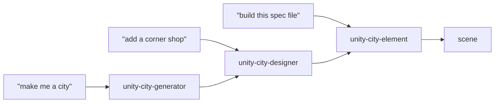
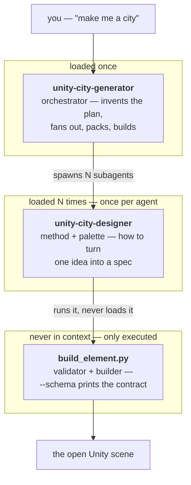
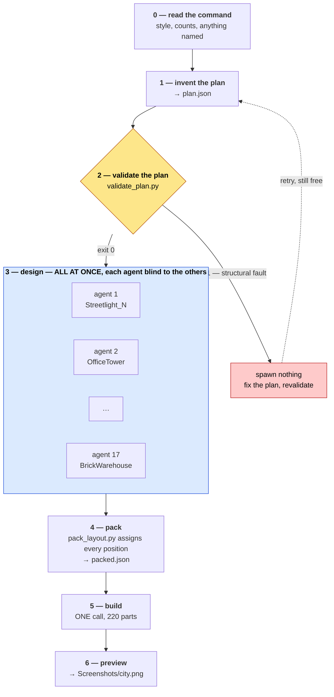
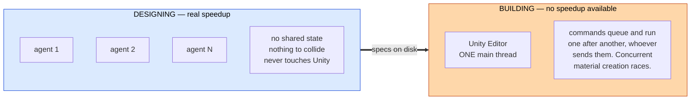
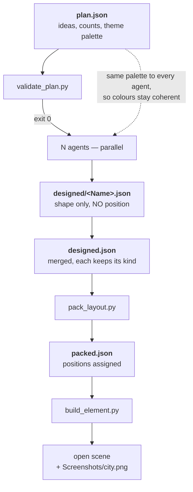
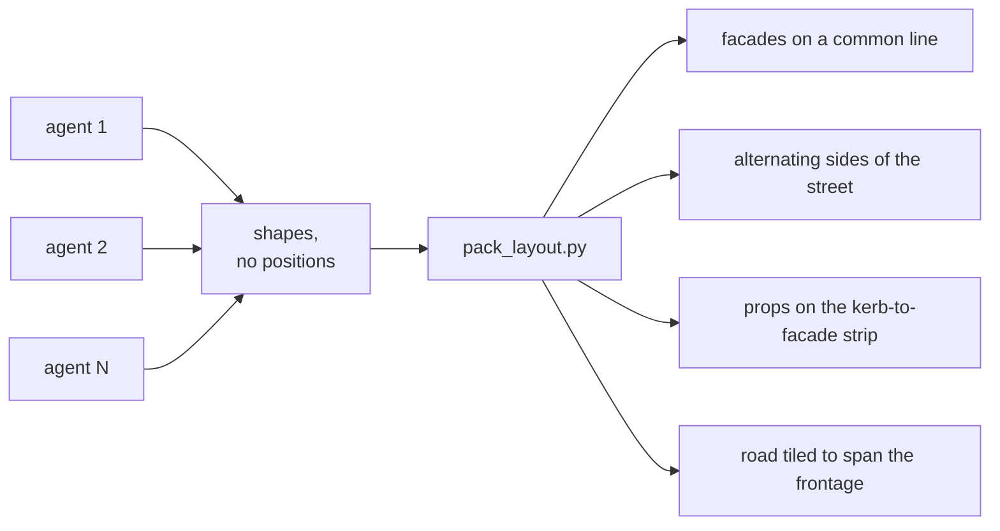
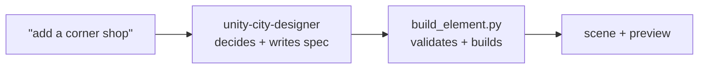

# SoftwareFactories

A Unity 6000.3.15f1 (URP) project with a three-skill stack for generating city
scenery out of Unity primitives, driven from Claude Code through a live Unity
Editor bridge.

Ask for a building and you get one. Ask for a city and you get a street.

---

## Requirements

- **Unity 6000.3.15f1** open on this project, with the command bridge running.
- The `unity` CLI at `/Users/juan/.unity/bin/unity` (not on `PATH` — always call
  it by full path). Override with the `UNITY_CLI` environment variable.
- **Python 3** for the three bundled scripts. No third-party packages.

Check the Editor is reachable before anything else:

```bash
/Users/juan/.unity/bin/unity --no-banner --non-interactive --json status
```

You need an instance with `"state": "ready"`. If it reports something else the
Editor is usually compiling or in play mode — wait and retry. If nothing is
connected, open the project; never fall back to hand-editing scene YAML.

---

## The skill stack

Three skills, each with one job. Only one is loaded per request, so the stack
costs no more than a single skill would.

| Skill | Decides | Produces |
|---|---|---|
| `unity-city-generator` | What a whole block contains | A built street |
| `unity-city-designer` | What one element looks like | A spec |
| `unity-city-element` | Nothing — it builds | Geometry in the scene |



That table answers *which skill handles which request*. For how a run actually
executes — what happens in parallel, what cannot — see below.

---

## How the flow works

The thing worth understanding is **which parts run at the same time and which
cannot**, because that decides both how long a run takes and what can go wrong
in it.

### Who loads what

Only one skill is in context at a time. Layers hand off through files and shell
commands, never by invoking each other as skills.



`unity-city-element/SKILL.md` is documentation for *you*. The pipeline never
reads it, which is why a build costs no skill tokens at all.

### The pipeline



Step 2 is the **last cheap moment**. Everything before it costs almost nothing;
everything after is paid per element.

### Measured timeline

A 17-element run, timed end to end. (The run folder kept in this repo is the
larger one, `city-runs/ruins/` — 72 elements, 50 buildings and 21 props of a
post-apocalyptic street; the numbers in [Where the tokens go](#where-the-tokens-go)
come from that one.)

```mermaid
gantt
    title 17-element run — wall clock
    dateFormat X
    axisFormat %M:%S

    section Orchestrator
    read command and invent plan :done, q1, 0, 2
    validate plan               :crit, q2, 2, 3

    section Design agents (parallel)
    StreetTree_N                :active, a1,  3, 31
    Streetlight_E               :active, a2,  3, 32
    Streetlight_W               :active, a3,  3, 41
    LitterBin                   :active, a4,  3, 42
    CityRoad                    :active, a5,  3, 48
    BenchPair                   :active, a6,  3, 48
    StreetTree_S                :active, a7,  3, 57
    OfficeTower                 :active, a8,  3, 66
    CornerCafe                  :active, a9,  3, 75
    CityHotel                   :active, a10, 3, 78
    BusShelter                  :active, a11, 3, 79
    ParkingDeck                 :active, a12, 3, 82
    OldChapel                   :active, a13, 3, 91
    CivicLibrary                :active, a14, 3, 95
    CycleStand                  :active, a15, 3, 97
    ApartmentBlock              :active, a16, 3, 102
    BrickWarehouse              :active, a17, 3, 138

    section Orchestrator
    pack                        :done, q3, 138, 139
    build 220 parts             :crit, q4, 139, 299
    preview                     :done, q5, 299, 303
```



**19.2 minutes of design work in 2.3 minutes of wall clock** — about 8.5× — for
roughly 1M tokens. That ratio is the entire reason the fan-out exists. Note also
that the single build call takes longer than all but the slowest agent.

### Why designing is parallel but building is not



So agents never touch the Editor. They self-check with
`build_element.py --dry-run`, which needs no Editor at all, and the single build
call at the end is the only thing that talks to it.

### What each step hands to the next



Everything except the scene itself lives in `city-runs/<run>/`, so a city can be
rebuilt or edited later without paying for the agents again.

### Why agents never choose a position

They run concurrently, so no agent can see where the others put anything.
Letting each pick its own spot would mean collisions nobody detects.



`pack_layout.py` takes footprints from `build_element.py --dry-run` — the same
code that will place the geometry — so what is packed is exactly what gets built.

Sequential agents *could* each read the scene and place themselves, but that
forces the whole run to be serial — N scene reads and N builds instead of one —
to solve a problem footprints already solve.

### Where the tokens go

Ranked by what moves the bill on a real run. Everything before step 3 is
rounding error; everything from step 3 on is paid per element.

| # | Hotspot | Why it costs | What to do instead |
|---|---|---|---|
| 1 | **Orchestrator turn count** | Every reply re-sends the whole conversation. On the 72-element run the orchestrator spent **96.7M** tokens against the agents' **32.8M** — 3× — over 164 turns each re-reading 566k of context, largely to say "65/72 done". | Launch a full wave, stay silent, answer once when the wave lands. Check progress by listing `designed/`, never by narrating completions. |
| 2 | **The fan-out itself** | ~446k raw tokens and 9 model calls per agent. Only **2.7%** is generated output; the rest is context mechanics. N comes straight from the counts in step 0. | State the counts in one line before spawning. That is the last cheap moment to change scale. |
| 3 | **Re-running the generator to fix one element** | Re-pays every design agent, and invents a *different* city. | Edit the file in `designed/`, re-pack, rebuild from `packed.json`. Costs zero agents. |
| 4 | **Reading the run files into context** | `packed.json` from the 72-element run is 564 KB — roughly 140k tokens if it lands in context. `designed.json` is 268 KB. | Never `cat` them. Query with `python3 -c` or `jq` and print counts; otherwise let the scripts read them off disk. |
| 5 | **Per-agent skill loading** | Pointing each agent at the designer skill plus the catalog makes it read ~20 KB before it starts — duplicated N times. | The brief in the generator skill is deliberately self-contained, and sends an agent to the catalog only if it gets stuck. |
| 6 | **Preview screenshots** | Each image read back costs vision tokens, once per review iteration. | One overhead preview per build. Look once, fix, rebuild. |
| 7 | **Scene reads** | `scene.get_hierarchy` on a populated scene is large output. | Read it once, when extending an existing city to choose `--origin-x`. |

Weighted for price, the agents and the orchestrator came out roughly equal on
real work — the 3× gap was commentary. So the lever is **turn count, not agent
count**.

### The single-element path

Asking for one thing skips the orchestration entirely. No subagents, no packing,
nothing parallel:



## Using it

### One element

> "add a corner shop with a red awning"

`unity-city-designer` picks it up, adapts a validated recipe from its catalog,
writes a spec, builds it and screenshots the result. Review the image and say
what to change.

### A whole block

> "/unity-city-generator run-down industrial canal street, 10 buildings and
> lots of street furniture"

Style and counts come from your words — any free text works. With nothing
specified it defaults to **8 buildings, 8 props, 1 road, contemporary generic
city**, and states the numbers it settled on before spawning anything, so you
can change scale while it is still free.

`unity-city-generator`:

1. **Reads the command** — style/theme, how many buildings, how many props,
   anything you named specifically.
2. **Invents a plan** of element ideas — one line each, open-ended, not from
   a fixed list — plus any extra colours the theme needs.
3. **Validates the plan** before spawning anything. Structural faults reject
   outright; quality faults (every building the same height, ideas too thin to
   design from, too few props) are reported to fix first. Fanning out is the
   expensive step, so this is the last cheap moment to catch a mistake.
4. **Spawns one subagent per idea**, in waves of 20 (the concurrency cap). Each
   designs a shape and writes a JSON file. They never choose a position and
   never touch Unity.
5. **Packs the designed shapes** into a street grid: buildings dealt across
   several east-west streets with facades on a common line, north-south cross
   streets closing the block, props on the kerb-to-facade strip, road tiled to
   span every frontage.
6. **Builds everything in one call** and screenshots it.

### Run folders

Each generator run keeps its working files under `city-runs/<run>/`:

```
city-runs/canal-street/
├── plan.json          the invented ideas
├── designed/*.json    one spec per element, as written by the subagents
└── packed.json        everything, positioned
```

This is what makes a city reproducible. Designing is the expensive step —
roughly 446k raw tokens per element designed — so the results are kept rather
than thrown away. To rebuild exactly, or after editing one
element:

```bash
python3 .claude/skills/unity-city-element/scripts/build_element.py \
    city-runs/canal-street/packed.json --replace --preview Screenshots/city.png
```

Re-running the generator invents a *different* city, so never use it to fix one
building. `city-runs/` is gitignored and lives outside `Assets/` so Unity
doesn't import it.

Note the two different "catalogs": the **recipe catalog** shipped with
`unity-city-designer` is fixed and reused on every run, while a run's
`plan.json` is invented fresh each time.

Parallelism is in the *designing*. Building is one call because the Unity Editor
is single-threaded — concurrent builds gain nothing and race on material assets.

For what a run actually costs and which parts of it dominate, see
[Where the tokens go](#where-the-tokens-go).

### Driving the builder yourself

```bash
B=.claude/skills/unity-city-element/scripts/build_element.py

python3 $B --schema                   # the complete input contract
python3 $B spec.json --dry-run        # validate only; needs no Editor
python3 $B spec.json --preview        # build and screenshot
python3 $B spec.json --replace --save # rebuild in place and persist
```

| Flag | Effect |
|---|---|
| `--dry-run` | Validate and print placements. No Editor contact. |
| `--json` | One machine-readable result object, for agent callers. |
| `--replace` | Delete a same-named element first instead of refusing. |
| `--preview [path]` | Screenshot to `Assets/Screenshots/<name>.png`. |
| `--preview-angle <deg>` | Camera elevation. Default 18 for one element, 72 for a layout. |
| `--save` | Save the scene. Without it the build stays in memory. |

Exit codes: `0` built · `1` spec refused · `2` unreadable spec · `3` no Editor ·
`4` build failed partway.

Checking a plan before spawning agents, and packing the results afterwards:

```bash
R=city-runs/<run>
python3 .claude/skills/unity-city-generator/scripts/validate_plan.py \
    $R/plan.json --buildings 8 --props 8 --check-scene
python3 .claude/skills/unity-city-generator/scripts/pack_layout.py \
    $R/designed.json -o $R/packed.json [--rows N] [--origin-x 0]
```

`validate_plan.py` exits 1 on structural faults (duplicate names, bad kind,
missing footprint, two roads, a count that doesn't match what was asked for, a
name already used in the scene) and 0 with warnings on quality ones.

---

## Writing a spec by hand

```json
{
  "name": "CornerShop",
  "position": [0, 0, 0],
  "materials": {"Brick": "#9C5B45FF", "Glass": "#6FA8C7FF"},
  "parts": [
    {"name": "Walls",  "primitive": "cube", "material": "Brick",
     "size": [6, 4, 5],     "at": [0, 0, 0]},
    {"name": "Window", "primitive": "cube", "material": "Glass",
     "size": [3, 1.8, 0.2], "at": [0, 1, -2.55]}
  ]
}
```

Wrap several in `{"elements": [ ... ]}` to build a street in one call.

Two fields carry the geometry:

- **`size`** is real-world **metres**, not a scale factor.
- **`at`** is the centre of the part's **bottom face**. `"at": [0,0,0]` sits it
  on the ground. Use `"center"` instead for rotated parts.

An element may also carry `"rotation": [x,y,z]` to turn the whole thing, and
`"kind"`, whose only effect is that two elements both marked `road` may overlap
without a warning — that is what an intersection is.

### Why metres and not scales

Unity primitives have centred pivots and inconsistent native sizes — the single
biggest source of wrong-looking primitive scenes:

| Primitive | Size at scale 1 | |
|---|---|---|
| cube, sphere, quad | 1 | |
| **cylinder, capsule** | 1 × **2** × 1 | two units tall, not one |
| plane | 10 × 10, flat | scaling y does nothing |

A 5 m lamppost is a cylinder with `scale.y = 2.5` placed at `y = 2.5` — two
corrections, and missing either buries it in the road. Give `size` and `at` and
the builder derives both.

---

## When the builder refuses

A refusal creates **nothing**, and reports every fault at once so one fix clears
them all. It refuses rather than quietly repairing, because a silent correction
makes the caller's description a lie.

| Code | Meaning |
|---|---|
| `part_hidden_inside` | The part is entirely within another and would be invisible. |
| `part_below_ground` | It dips under y=0. Raise it, or set `"below_ground": true`. |
| `undefined_material` | A part names a material missing from `materials`. |
| `unknown_primitive` | Not cube, sphere, cylinder, capsule, plane or quad. |
| `bad_size` | A size component is zero or negative. |
| `name_taken` | A scene root already has that name — pass `--replace`. |
| `origin_below_ground` | The element's own `position` has y < 0. |

Warnings don't stop a build: `elements_overlap`, `coplanar_faces`,
`material_color_ignored`.

### Primitives are solid

`part_hidden_inside` catches the most common modelling mistake. A primitive has
no interior, so anything placed inside one simply vanishes — water sunk into a
basin, a bulb inside a shade. No command output would tell you; only a
screenshot would.

Build hollows by implication: the water disc sits slightly *above* the basin
rim, a doorway is a darker slab on the facade. Keep such surfaces a couple of
centimetres clear of the face they sit on, since exactly coplanar faces flicker.

---

## Materials

One shared palette at `Assets/CityKit/Materials/<Role>.mat`, URP/Lit, coloured
via `_BaseColor`. The built-in `Standard` shader renders magenta in this
project.

Materials are named for the **role** the colour plays (`Concrete`, `Glass`,
`Brick`), never per object, and **an existing one is reused untouched and never
recoloured** — the palette is shared across the whole city, so restyling
`Concrete` would repaint every building using it. Need another shade? Name the
difference (`ConcreteDark`). Requesting a different colour for an existing role
builds with the existing one and warns `material_color_ignored`.

The standard palette lives in
`.claude/skills/unity-city-designer/references/catalog.md`, alongside twelve
validated element breakdowns.

Those twelve are **worked examples, not a menu** — they show how a good spec is
assembled, and are reliable starting points when a request matches one. They do
not limit what can be built: in the canal-street test, six subagents produced 83
parts of which only 11 shared a name with any example, inventing sawtooth
clerestories, per-floor balcony bands, security shutters and rust patches. The
palette, by contrast, *is* meant to constrain — shared colour roles are what
make separate elements read as one city.

---

## Verifying

Static validation proves geometry is possible. It cannot tell you a tower looks
squat or that two colours mush together, so **open the preview image**.

- A **single element** is shot from a low angle — you're judging whether it
  reads as the thing.
- A **layout** is shot from near overhead, because at street level the nearest
  frontage hides everything behind it, and what you're checking is spacing and
  variety. Pass `--preview-angle 14` for an eye-level look as well.

Don't use `capture.scene_view` with `Edit/Frame Selected`: framing aims at the
root pivot, which on a ground-anchored element is at its feet, so the camera
ends up inside the geometry.

---

## Gotchas

- **Nothing is saved unless you pass `--save`.** Saving is the only
  hard-to-undo step, so it's always an explicit choice.
- **Primitives arrive with colliders.** Fine for blockout; remove with
  `component.remove` if you don't want them.
- **Unity CLI arguments are `--name value`**, not `name=value`, which fails with
  `INVALID_COMMAND_ARGS`.
- **Adding to an existing city**: `pack_layout.py` prevents overlap only among
  the elements it places. It cannot see geometry from an earlier run — read the
  scene first and pass `--origin-x` clear of it.
- **Rotated parts get weaker checks.** The coplanar test skips them and bounds
  come from their bounding box, so pitched roofs and angled signage are
  validated less tightly than upright geometry.
- **Concurrent designers can't see each other's palettes.** Declare a theme's
  extra colours in the catalog up front; `pack_layout.py` reports any role that
  two designers defined differently.

---

## Layout

```
.claude/skills/
├── unity-city-generator/
│   ├── SKILL.md                     read command, invent plan, fan out, build
│   └── scripts/
│       ├── validate_plan.py         check the plan before spawning agents
│       └── pack_layout.py           assign positions from real footprints
├── unity-city-designer/
│   ├── SKILL.md                     decompose, proportion, colour, layout
│   └── references/catalog.md        12 validated recipes + standard palette
└── unity-city-element/
    ├── SKILL.md                     the contract, flags, refusal codes
    └── scripts/build_element.py     validate, place, build, screenshot
```

See `CLAUDE.md` for the general Unity CLI workflow in this project.
