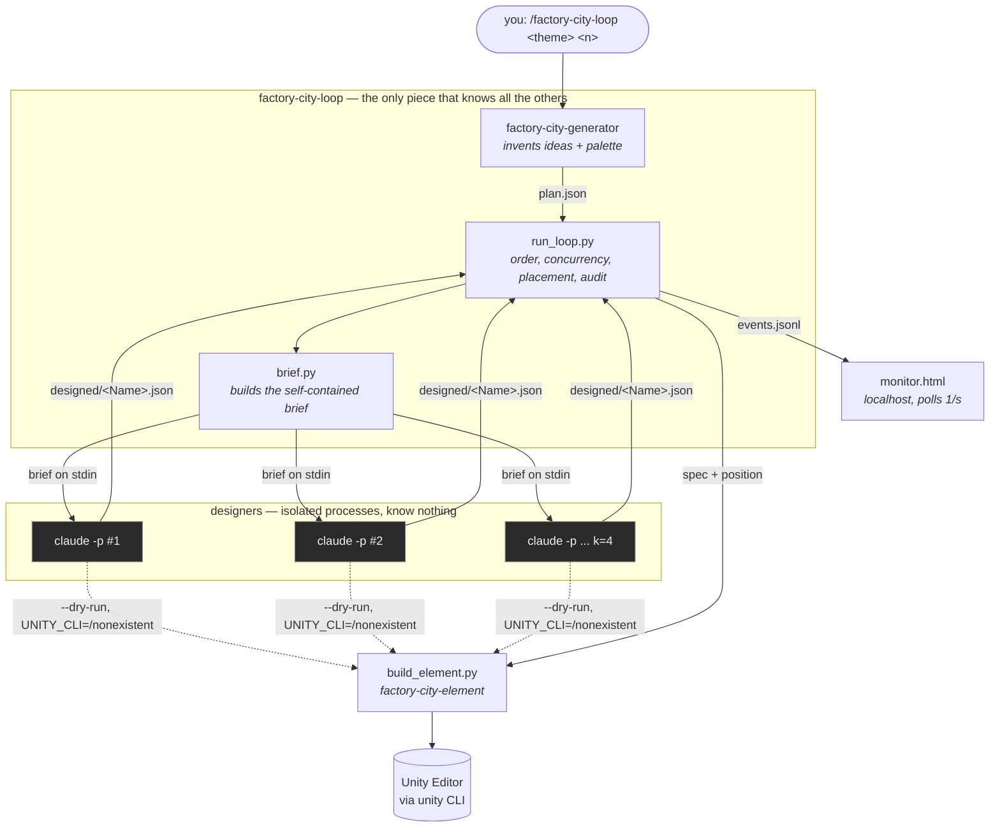
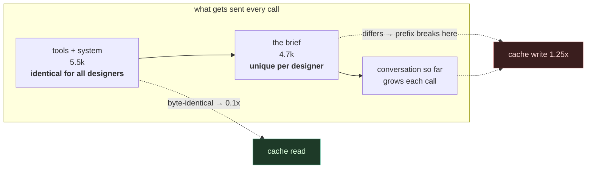
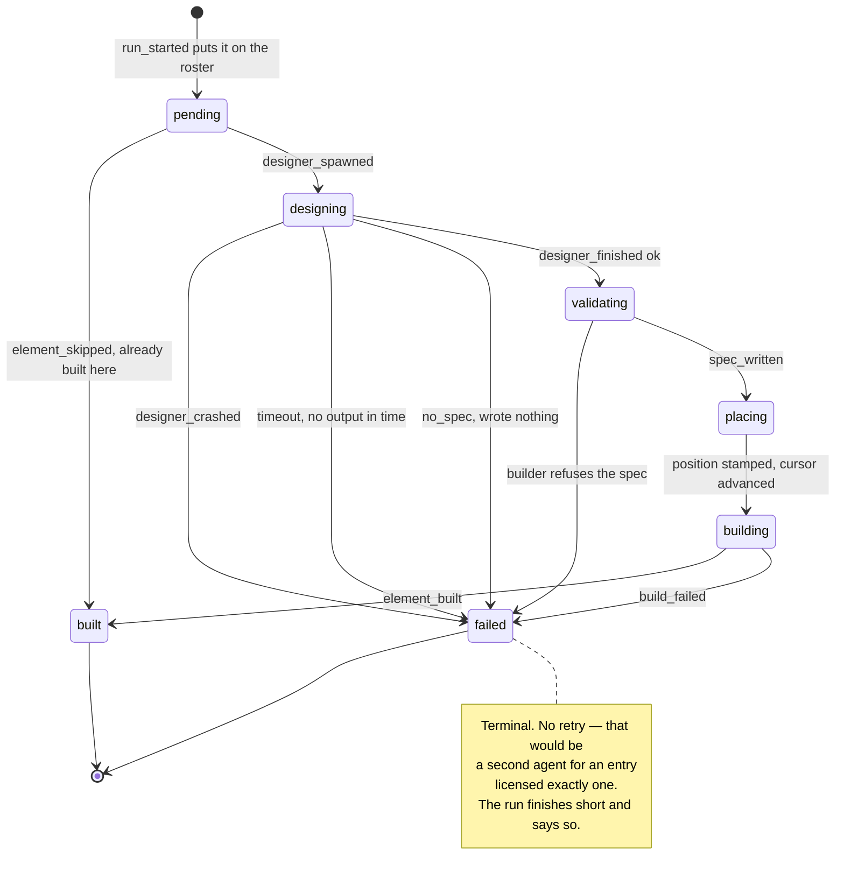
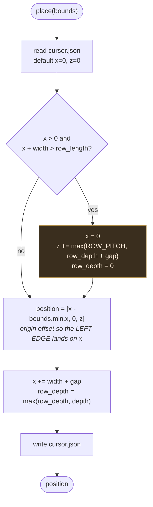

# SoftwareFactories

A Unity 6000.3.15f1 (URP) project that generates city scenery out of Unity
primitives, driven from Claude Code through a live Unity Editor bridge.

Ask for a building and you get one. Ask for a street and you watch it build
itself, one building at a time, in a browser tab.

---

## Requirements

- **Unity 6000.3.15f1** open on this project, with the command bridge running.
- The `unity` CLI at `/Users/juan/.unity/bin/unity` (not on `PATH` — always call
  it by full path). Override with the `UNITY_CLI` environment variable.
- **Python 3** for the bundled scripts. No third-party packages.
- The `claude` CLI on `PATH`, for the designer processes.

Check the Editor is reachable before anything else:

```bash
/Users/juan/.unity/bin/unity --no-banner --non-interactive --json status
```

You need an instance with `"state": "ready"`. If it reports something else the
Editor is usually compiling or in play mode — wait and retry. If nothing is
connected, open the project; never fall back to hand-editing scene YAML.

---

## Using it

### A street

```
/factory-city-loop arcología costera de ciencia ficción, 10 edificios
```

Any free text works. With no count it defaults to 10 buildings. It states the
numbers it settled on before spawning anything, so you can change scale while
it is still free.

A browser tab opens with a live monitor. Each building appears in the Editor
the moment its design lands — you do not wait for the batch.

### One building

```
/factory-city-designer una capilla de madera blanca con campanario
```

Produces a spec. `/factory-city-element` turns a spec into geometry.

---

## The four skills

The split is the point. **The loop orchestrates and knows all three others.
They know nothing — not each other, not their caller.**

```
         ideas          how to draw it        build it
plan.json ──▶ designer ──▶ spec.json ──▶ element ──▶ geometry
    ▲            (4 at a time, headless)       │
    └── factory-city-generator                 └──▶ events.jsonl ──▶ browser
```

| Skill | Decides | Never |
|---|---|---|
| `factory-city-generator` | what buildings exist, and the shared palette | how any of them look |
| `factory-city-designer` | parts, sizes, colours of **one** building | where it goes, or how Unity draws it |
| `factory-city-element` | Unity primitives, pivots, URP materials | shape, proportion, colour |
| `factory-city-loop` | order, concurrency, placement, the audit trail | anything creative |

A designer is handed a **brief**, not a collaborator. The builder's contract
travels inlined in that brief, because measured on a 95-agent run designers
re-read a `SKILL.md` 115 times between them despite never being told to.

---

## The flow, in detail

### Who knows whom

The arrows are the whole design. Nothing points sideways: a designer cannot
reach another designer, cannot read a skill file, and does not know the loop
exists. It receives one self-contained brief on stdin and writes one file.



The dotted arrows matter: a designer **does** run the builder, but with
`UNITY_CLI=/nonexistent`. It validates its own geometry against the contract
locally and never touches the Editor. Only the loop talks to Unity.

### One full run, end to end

```mermaid
sequenceDiagram
    autonumber
    participant L as run_loop.py
    participant P as ThreadPool k=4
    participant D as designer process
    participant B as build_element.py
    participant U as Unity Editor
    participant E as events.jsonl

    L->>E: run_started {theme, n, k, roster, model}
    L->>E: monitor {url}
    Note over L: browser tab opens

    rect rgb(60,50,30)
    Note over L,U: preflight — one Editor call, BEFORE any agent is spent
    L->>B: probe spec (deliberately refused on its merits)
    B->>U: is anyone there?
    U-->>B: exit 3 = no Editor
    B-->>L: exit code
    alt no Editor
        L->>E: run_aborted {editor_unavailable}
        Note over L: 0 agents spent, plan.json reusable
    end
    end

    L->>L: already = names with element_built in events.jsonl

    loop for each plan entry
        alt already built (resume)
            L->>E: element_skipped {already_built}
        else
            L->>P: submit(spawn, entry)
        end
    end

    par up to k designers at once
        P->>E: designer_spawned {name}
        P->>D: spawn, brief on stdin
        D-->>P: designed/&lt;Name&gt;.json
        P->>E: designer_finished {seconds, tokens, ok}
    end

    Note over L: builds happen HERE, in ONE thread —<br/>the Editor is single-threaded, so a designer<br/>finishing mid-build waits its turn
    loop as_completed — whichever designer lands first
        L->>B: --dry-run (validate + get bounds)
        B-->>L: {ok, parts, bounds}
        L->>E: spec_written {path, parts}
        L->>L: place(bounds) → position, advance cursor.json
        L->>L: stamp "position" into the spec
        L->>B: build for real
        B->>U: create GameObjects, URP materials
        U-->>B: ok
        B-->>L: {ok}
        L->>E: element_built {position, parts, seconds}
    end

    L->>L: count agents/*.jsonl NOT in plan.json
    L->>E: run_finished {built, failed, tokens, skipped, unplanned, seconds}
```

Step 9 and the `par` block are why a building appears in the Editor while
others are still being designed. The `unplanned` count at the end reads the
`.jsonl` files on disk rather than the list the spawns came from — a check
over its own input proves nothing.

### Inside one designer

This is where the cost lives. The API is **stateless**: every call re-sends
the entire conversation, and the conversation grows by whatever the model
itself wrote.

```mermaid
sequenceDiagram
    autonumber
    participant L as run_loop.py
    participant C as designer process
    participant A as Claude API
    participant F as designed/Name.json
    participant G as agents/Name.jsonl

    L->>L: brief = build_brief(entry, theme, palette, contract)
    Note over L: contract comes from build_element.py --schema,<br/>cached — N designers cost ONE subprocess
    L->>L: unlink any stale designed/Name.json
    L->>C: Popen(argv), brief on stdin, stderr→stdout
    L->>L: Timer(timeout) armed

    rect rgb(30,50,60)
    Note over C,A: call 1 — 5.5k base + 4.7k brief
    C->>A: [brief]
    A-->>C: thinking + tool_use(Write)
    end
    C->>F: the 28-part JSON
    C->>G: every stream line, flushed

    rect rgb(30,50,60)
    Note over C,A: call 2 — everything above PLUS the JSON it just wrote
    C->>A: [brief, JSON, "written"]
    A-->>C: tool_use(Bash)
    end
    C->>C: UNITY_CLI=/nonexistent build_element.py --dry-run

    rect rgb(30,50,60)
    Note over C,A: call 3 — plus the validator output (~2k chars)
    C->>A: [brief, JSON, "written", validator output]
    A-->>C: "done, 28 parts"
    end
    C->>G: result {usage}

    C-->>L: exit
    L->>G: (teed the whole time)
    L->>L: tokens = sum of result.usage
    alt timer fired
        L-->>L: reason=timeout
    else designed/Name.json missing
        L-->>L: reason=no_spec
    end
```



What grows the conversation is **not** the tool output — the validator returns
about 2 KB. It is the JSON the model wrote in call 1 riding along in calls 2
and 3. The model pays to re-read its own work.

Prompt caching makes that cheap. The prefix order is `tools → system →
messages`, and caching is prefix-exact:



Designer B does not read anything *of* designer A. It builds the same 5.5k
system prompt independently; the server recognises the identical prefix and
charges 0.1x instead of recomputing. No information crosses between agents —
and the brief, the only part that differs, is the part that never shares.

### The life of one plan entry

Exactly one agent per entry, no exceptions, no retries.



A `failed` entry costs the building, not the run. Re-running the same folder
picks up only the `failed` and the never-attempted ones.

### Where a building lands

The loop assigns every position; no agent ever chooses one. `place()` reads
the builder's own dry-run bounds, so what gets placed is exactly what gets
built.



Two details that are easy to get wrong and are deliberate here: the row wraps
**before** placing, so nothing straddles the end of a row; and the step to the
next row uses the deepest thing in the row just finished, because a fixed
pitch drops the new row inside the old one the moment anything is deeper.

The cursor lives in the run folder, which is why a *new* folder starts at
x=0 and will build on top of an earlier run's geometry.

---

## What a run costs

Measured, 10 buildings, from the stored agent logs:

| | designers on Opus, default session | **current: Haiku, stripped session** |
|---|---|---|
| cost | $5.82 | **$0.084** |
| tokens | 2.39M | 533k |
| design, per building | 91–209 s | **29–80 s** |
| build, per building | 5–25 s | **3–6 s** |
| whole run | 392 s | **160 s** |
| API calls per designer | 3–14 | **3–6** |

Three things got it there, in order of weight:

**1. The model.** Writing a 28-part JSON against a contract handed over in
full is not Opus work. 44% of the old bill was output tokens at $25/MTok.
Designers run on Haiku; `--model sonnet` if a theme needs more invention.

**2. The session.** Each designer was starting a full Claude Code session —
29 tool definitions, 118 slash commands, `CLAUDE.md` and the `SessionStart`
hooks — 28k of prompt before the brief, for an agent that uses three tools.
`--tools`, `--setting-sources ""` and `--strict-mcp-config` cut it to 5.5k.

**3. The warning loop.** The brief said "fix anything it refuses", and one
designer read that as licence to chase `coplanar_faces` — a *warning* — for
14 calls and 28% of the run's tokens. It now says errors only.

### Why the token count overstates the bill

Most of a run's tokens are **cache reads**, billed at 0.1x. The API is
stateless: to let the model see what it wrote two calls ago, the whole
conversation is re-sent every time. That re-sending is real and it is
enormous — and it was only 16% of the old bill. The breakdown that matters:

```
writing the prompt into cache   40%    ← the fat session, mostly
RE-READING it (the re-send)     16%
model output                    44%    ← the actual work
```

At Haiku prices the re-send falls to 2.7% of a total that is itself 69x
smaller. Optimise output tokens and prompt size; the re-send is a red herring.

---

## What a run leaves behind

```
factory-runs/<slug>/
├── plan.json            the closed census: one entry, one agent, no exceptions
├── events.jsonl         the timeline
├── agents/<name>.jsonl  one per agent, every operation it performed
├── designed/<name>.json each spec, with the position the loop assigned
└── cursor.json          where the row got to
```

**Nothing is reconstructed from memory. If it is not in a file, it did not
happen.** Every number in the table above came out of `agents/*.jsonl` — the
raw stdout of each designer process, flushed line by line so it survives a
crash. The folder is not cleaned between runs: the audit trail is the point.

Unplanned agents are counted from the `.jsonl` files on disk, not from the
list the spawns were drawn from — a check over its own input proves nothing.

### Re-running the same folder

Safe, and the cheapest way to finish a run that came up short. Anything
`events.jsonl` records as built is skipped — no agent, no cost. The cursor
continues the row rather than restarting it, so nothing lands on top of what
is there. To redesign something that did build, delete its `element_built`
line from `events.jsonl`.

---

## What it will not do

- **Retry.** A designer that writes nothing, hangs, or produces a spec the
  builder refuses marks that building `failed` and the loop moves on. A retry
  would be a second agent for an entry licensed exactly one.
- **Compose a city.** Buildings go in a row.
- **See what is already in the scene.** A *new* run folder starts its cursor at
  x=0 and will build on top of earlier geometry. Reuse the folder, clear the
  scene, or seed `cursor.json` with another row's `z`.
- **Save the scene.** Nothing is persisted unless you ask.

### When it aborts

`aborted: no Unity Editor on the bridge` means the preflight found no Editor
and **no agents were spent**. Check `unity status` and run the same command
again — `plan.json` is still there and costs nothing to reuse.

---

## Scripts

```
.claude/skills/
├── factory-city-generator/scripts/validate_plan.py   plan sanity, before any spawn
├── factory-city-element/scripts/build_element.py     spec → Unity (--dry-run, --schema)
└── factory-city-loop/scripts/
    ├── run_loop.py      the loop            (--selftest, --model, --k)
    ├── brief.py         what a designer is handed   (--selftest)
    └── monitor.html     the live page
```

Every script with non-trivial logic carries a `--selftest` that runs with no
Editor and no agents.
